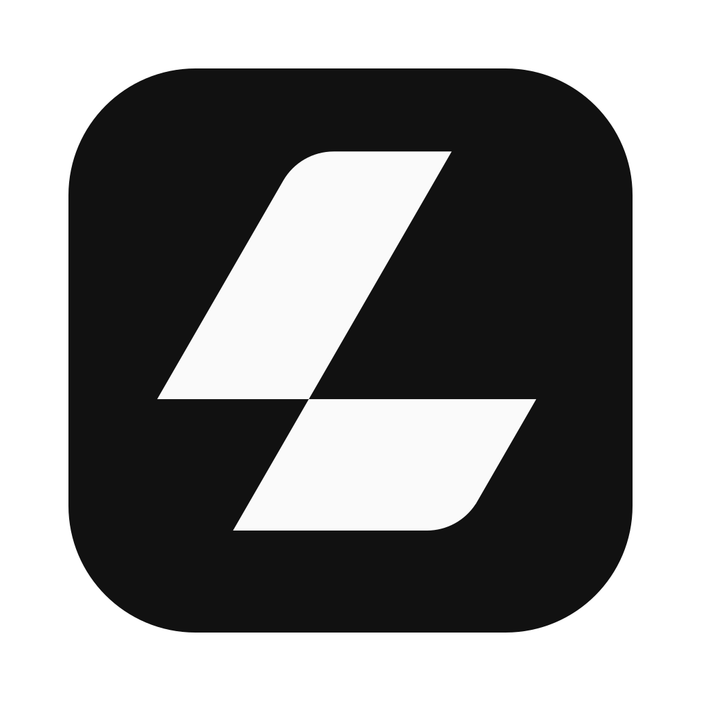
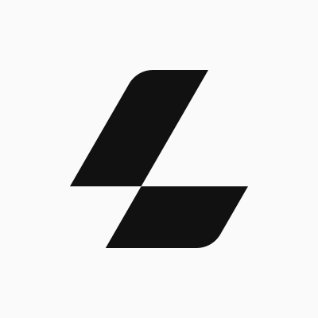
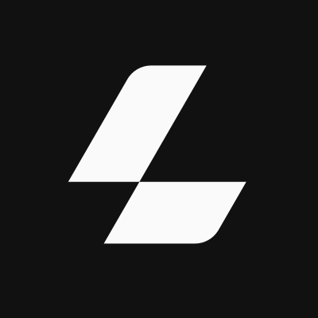
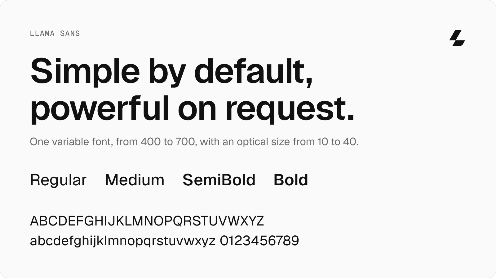
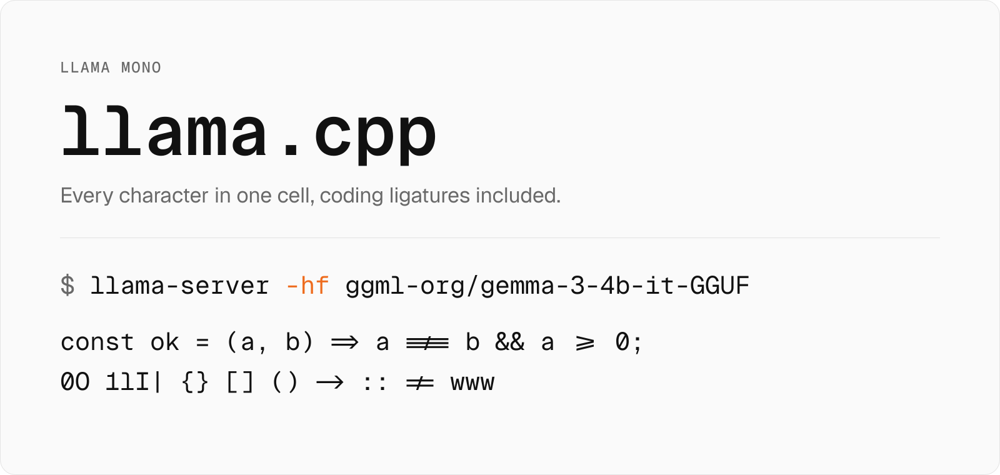
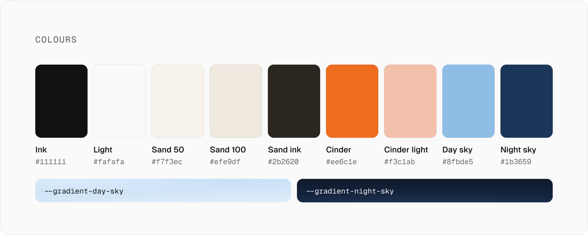

# llama-brand

Official brand assets for **Llama.app** and **llama.cpp**: the logo, the Llama type family, and the colours and core CSS that everything the brand makes is built on, from the web UI to posts, posters and swag.

```
logo/     the icon, the lockups, the covers, app icons and social profiles as SVG, WebP and PNG, plus the logo showcase
fonts/    Llama Sans and Llama Mono, their build scripts and the specimen
css/      the colours, the font faces, and communications' grounds and type scale
readme/   this README's artwork, built from the fonts and the colours
```

Install it from GitHub and import files by path:

```bash
npm i github:ggml-org/llama-brand
```

```css
@import 'llama-brand/css/brand.css';
```

```js
import logo from 'llama-brand/logo/svg/lockup/llama/logo-llama-light.svg';
```

---

## Logos

### Llama

| Light | Dark |
|-------|------|
|  |  |

### llama.cpp

| Light | Dark |
|-------|------|
|  |  |

"Llama" is set in Llama Sans Bold and "llama.cpp" in Llama Mono Bold, always lowercase, with `.cpp` in cinder. The llama.cpp lockup always sits on a neutral ground; only the Llama lockup goes on colour.

### Icon

| Light | Dark |
|-------|------|
|  |  |

Every icon and lockup also comes on its background (`-bg`), with the icon optically centred.

### Covers

| Light | Dark |
|-------|------|
|  |  |
|  |  |

### App icons and social profiles

| | Light | Dark |
|---|---|---|
| macOS |  |  |
| X avatar |  |  |

- **App icons** ([`logo/svg/app/`](./logo/svg/app)): iOS and macOS, Android (adaptive, monochrome and Play), Windows (app icon and tiles), a PWA (regular and maskable) and the web UI's favicons, light and dark.
- **Social profiles** ([`logo/svg/social/`](./logo/svg/social)): avatars and banners for X, LinkedIn and YouTube, at each platform's size and inside its safe area.

Every SVG also comes as a lossless WebP under [`logo/webp/`](./logo/webp) and a PNG under [`logo/png/`](./logo/png), in the same layout. See [`logo/`](./logo) for how the files are built and for the showcase that takes the icon apart.

---

## Fonts

<picture>
  <source media="(prefers-color-scheme: dark)" srcset="./readme/llama-sans-dark.svg">
  
</picture>

**Llama Sans** is one variable font from 400 to 700, with an optical size axis from 10 to 40: spaced for interfaces (UI) at 16, tighter for headlines (Display) at its large end and looser for small text under 16, which browsers pick from the font-size.

<picture>
  <source media="(prefers-color-scheme: dark)" srcset="./readme/llama-mono-dark.svg">
  
</picture>

**Llama Mono** is its monospaced sibling, for code, commands and numbers in columns: every character in one cell, its coding ligatures included.

Both carry the Llama icon as glyphs: U+E000 for headlines, and U+E002, the lockup in one character, typed straight before the name. Llama Sans also has U+E001, the icon at 1.24 times the cap height, for small text and buttons; Llama Mono has no U+E001. Both are under the SIL Open Font License 1.1. See [`fonts/`](./fonts) for the details, the builds and the specimen.

---

## Colours

<picture>
  <source media="(prefers-color-scheme: dark)" srcset="./readme/colours-dark.svg">
  
</picture>

Grounds stay neutral as a rule: the logo's ink and light, paper and sand. Cinder is the one accent: the `.cpp` of the llama.cpp logotype, and a mark on a detail. The colours are for shapes, figures and accents, never for status.

| | Name | Token | Value |
|---|---|---|---|
|  | Ink | `--brand-ink` | `#111111` |
|  | Light | `--brand-light` | `#fafafa` |
|  | Sand 50 | `--sand-50` | `#f7f3ec` |
|  | Sand 100 | `--sand-100` | `#efe9df` |
|  | Sand ink | `--sand-900` | `#2b2620` |
|  | Cinder | `--art-cinder` | `#ee6c1e` |
|  | Cinder light | `--art-cinder-light` | `#f3c1ab` |
|  | Day sky | `--art-day-sky` | `#8fbde5` |
|  | Night sky | `--art-night-sky` | `#1b3659` |

The day sky and the night sky also come as gradient grounds (`--gradient-day-sky`, `--gradient-night-sky`), from llama.app's light and dark hero. The greys are Tailwind's neutral scale plus four in-between steps (`--neutral-0` to `--neutral-950`). [`css/colors.css`](./css/colors.css) has every value, in OKLCH.

---

## CSS

```
css/brand.css            everything below, in one import
css/colors.css           the colours above, as custom properties on :root
css/fonts.css            @font-face for Llama Sans and Llama Mono, and --font-sans and --font-mono
css/communications.css   the grounds and the type scale for posts, posters, boards and other visual assets
```

Communications measure everything in `--u`, a 24th of the format's short side (45px on a 1080 × 1080 post), which the layout sets. A piece takes `.ground` and one of `.ground-light`, `.ground-dark`, `.ground-sand`, `.ground-day` or `.ground-night`, which set its background and inks (`--p-ink`, `--p-muted`, `--p-line` and the rest). Its text takes the type scale: `.t-label`, `.t-body`, `.t-lede`, `.t-headline`, `.t-display`, `.t-figure` and `.t-mono`.

The llama.cpp web UI's design system builds on the same colours, with the same names, and adds what only an interface needs: status colours, translucent whites and blacks, and its type, length and radius scales.

---

## License

The logo assets are licensed under CC BY-NC 4.0, see [`LICENSE`](./LICENSE).

Distributions, packagers, and anyone referring to the project should read [`BRAND-USAGE.md`](./BRAND-USAGE.md), which grants the permissions that use needs.

The CSS is under the same licence as the logo assets. The fonts are released under the SIL Open Font License 1.1, see [`fonts/OFL.txt`](./fonts/OFL.txt). The Llama icon they carry at U+E000, U+E001 and U+E002 stays under the logo licence above.
