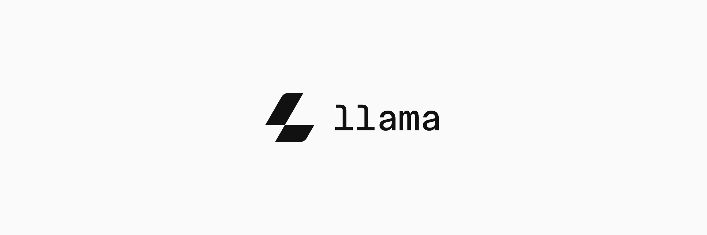
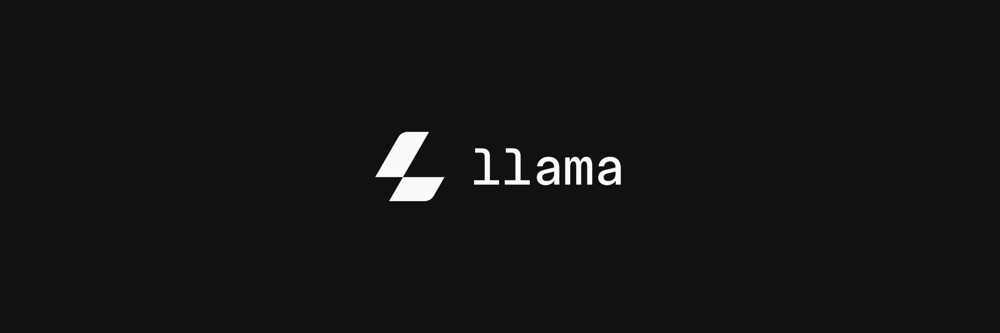
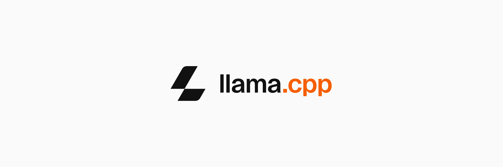
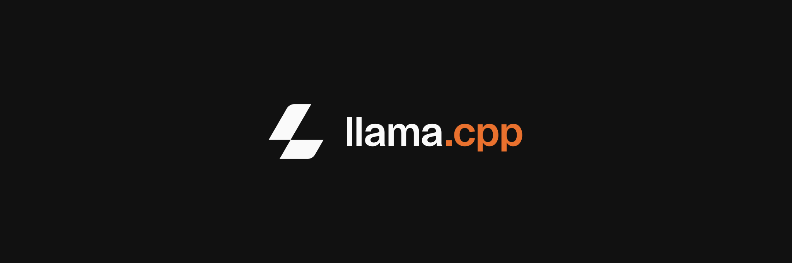

# llama.brand

Official brand assets for **Llama.app** and **Llama.cpp**: the logo and the Llama type family.

```
logo/    the icon, the lockups and the covers as SVG and WebP, plus the logo showcase
fonts/   Llama Sans (Display, UI, Text), its build scripts and its specimen
```

---

## Logos

### Llama

| Light | Dark |
|-------|------|
|  |  |

### Llama.cpp

| Light | Dark |
|-------|------|
|  |  |

---

## Icons

| Light | Dark |
|-------|------|
|  |  |

---

## Cover Images

### Llama

| Light | Dark | Alt |
|-------|------|-----|
|  |  |  |

### Llama.cpp

| Light | Dark | Alt |
|-------|------|-----|
|  |  |  |

Every SVG also comes as a lossless WebP under [`logo/webp/`](./logo/webp), in the same layout. See [`logo/`](./logo) for the showcase that takes the icon apart.

---

## Fonts

**Llama Sans** is the sans of the Llama type family, with Mono and Serif to follow: three variable fonts from 400 to 700 with identical outlines, Display for headlines, UI for interfaces and Text for prose. See [`fonts/`](./fonts).

---

## License

The logo assets are licensed under CC BY-NC 4.0, see [`LICENSE`](./LICENSE).

Distributions, packagers, and anyone referring to the project should read [`BRAND-USAGE.md`](./BRAND-USAGE.md), which grants the permissions that use needs.

The fonts are released under the SIL Open Font License 1.1, see [`fonts/OFL.txt`](./fonts/OFL.txt). The Llama icon they carry at U+E000 stays under the logo licence above.
